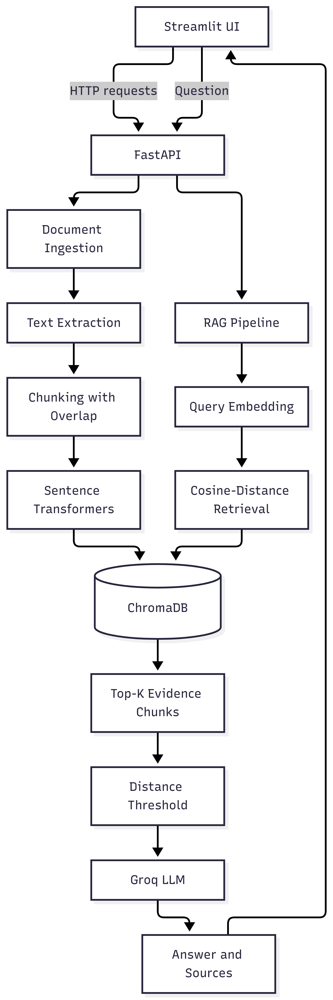

# RAG API

A document-grounded Retrieval-Augmented Generation (RAG) application built using FastAPI, ChromaDB, Sentence Transformers, Groq, and Streamlit.

The application allows users to upload documents, inspect their chunks, ask questions against the indexed knowledge base, and view retrieved evidence. It includes a basic abstention mechanism to reduce unsupported answers when sufficient relevant evidence cannot be retrieved.

## Features

- **Document ingestion:** Upload PDF, TXT, and Markdown files.
- **Text extraction:** Extract text from supported document formats.
- **Chunking with overlap:** Split extracted text into manageable chunks while preserving contextual continuity.
- **Embedding generation:** Generate embeddings using `sentence-transformers/all-MiniLM-L6-v2`.
- **Persistent vector storage:** Store document chunks, embeddings, and metadata in ChromaDB.
- **Semantic retrieval:** Retrieve the top-K chunks using cosine distance.
- **LLM-powered answers:** Generate responses using Groq's `openai/gpt-oss-20b` model.
- **Evidence inspection:** Display source filenames, excerpts, and retrieval distances.
- **Document management:** List indexed documents and delete their stored chunks.
- **Basic abstention:** Return an insufficient-evidence response when no retrieved chunks satisfy the configured distance threshold.
- **Interactive UI:** Upload documents, inspect chunks, and ask questions through Streamlit.
- **REST API:** Expose ingestion, retrieval, document management, and health-check endpoints through FastAPI.

## Tech Stack

| Component | Technology |
|---|---|
| Language | Python 3.11 |
| Backend API | FastAPI |
| API server | Uvicorn |
| Frontend | Streamlit |
| LLM provider | Groq API |
| LLM model | `openai/gpt-oss-20b` |
| Embedding model | `sentence-transformers/all-MiniLM-L6-v2` |
| Vector database | ChromaDB |
| Document parsing | pypdf |
| HTTP client | Requests |
| Testing | pytest, HTTPX |

## System Architecture

The following flowchart illustrates the document ingestion pipeline, vector storage, query retrieval, evidence filtering, and answer generation.



### Workflow

**Document ingestion**

1. The user uploads a PDF, TXT, or Markdown document through the Streamlit UI.
2. Streamlit sends an HTTP request to the FastAPI backend.
3. The ingestion service extracts the document text.
4. The extracted text is divided into overlapping chunks.
5. Sentence Transformers generates embeddings for each chunk.
6. ChromaDB stores the embeddings, chunk text, and associated metadata.

**Question answering**

1. The user submits a question through the Streamlit UI.
2. FastAPI passes the question to the RAG pipeline.
3. Sentence Transformers generates an embedding for the query.
4. ChromaDB retrieves the top-K semantically similar chunks using cosine distance.
5. The retrieved chunks are filtered using a configurable distance threshold.
6. The qualifying evidence is passed to the Groq LLM with instructions to answer using the supplied context.
7. The API returns the answer, abstention status, and retrieved source information.
8. Streamlit displays the response and evidence to the user.

## Project Structure

```text
RAG/
├── app/
│   ├── __init__.py
│   ├── main.py
│   ├── api/
│   │   ├── __init__.py
│   │   └── routes.py
│   ├── core/
│   │   └── config.py
│   └── services/
│       ├── ingestion.py
│       ├── vector_store.py
│       └── rag.py
├── tests/
│   ├── test_ingestion.py
│   └── test_api.py
├── images/
│   └── Flow_Chart.png
├── data/
│   ├── chroma/
│   └── uploads/
├── ui.py
├── requirements.txt
├── .env.example
├── .gitignore
└── README.md
```

The `data/chroma/` directory contains the persistent ChromaDB data. The `.env` file contains local configuration and secrets and should not be committed to Git.

## Prerequisites

Install the following before setting up the project:

- Python 3.11
- Git
- Visual Studio Code or another Python IDE
- A Groq API key

Create a Groq API key from the [Groq Console](https://console.groq.com/keys).

## Setup and Installation

### 1. Clone the repository

```powershell
git clone <YOUR_GITHUB_REPOSITORY_URL>
cd RAG
```

Replace the placeholder with your repository URL.

If the project is already present on your machine, open its root directory in VS Code instead.

### 2. Create a virtual environment

On Windows PowerShell:

```powershell
py -3.11 -m venv .venv
```

Activate the environment:

```powershell
.\.venv\Scripts\Activate.ps1
```

If PowerShell prevents activation, you can use the environment's Python executable directly:

```powershell
.\.venv\Scripts\python.exe --version
```

### 3. Install dependencies

Upgrade pip:

```powershell
python -m pip install --upgrade pip
```

Install the project dependencies:

```powershell
pip install -r requirements.txt
```

The project dependencies include:

- `fastapi`
- `uvicorn`
- `python-multipart`
- `pydantic-settings`
- `python-dotenv`
- `chromadb`
- `sentence-transformers`
- `groq`
- `pypdf`
- `streamlit`
- `requests`
- `pytest`
- `httpx`

Use the provided `requirements.txt` as the source of truth for package versions.

The embedding model is downloaded automatically when it is first loaded. An internet connection is required for the initial download.

### 4. Configure environment variables

Create a `.env` file in the project root by copying the example configuration:

```powershell
Copy-Item .env.example .env
```

If `.env.example` is unavailable, create `.env` manually with the following configuration:

```dotenv
GROQ_API_KEY=your_groq_api_key_here

LLM_MODEL=openai/gpt-oss-20b
EMBEDDING_MODEL=sentence-transformers/all-MiniLM-L6-v2

CHROMA_PERSIST_DIRECTORY=./data/chroma

CHUNK_SIZE=400
CHUNK_OVERLAP=60
RETRIEVAL_TOP_K=5
MAX_UPLOAD_MB=10
MAX_COSINE_DISTANCE=0.75
```

Replace `your_groq_api_key_here` with your actual Groq API key.

**Important:** Never commit `.env` or expose your API key in source code, screenshots, or public repositories. Only commit `.env.example` with the secret value left blank.

## Groq Configuration

This project uses Groq for LLM-based answer generation.

1. Open the [Groq Console](https://console.groq.com/keys).
2. Create an API key.
3. Add the key to `GROQ_API_KEY` in your `.env` file.
4. Set `LLM_MODEL=openai/gpt-oss-20b`.
5. Restart the FastAPI server after changing environment variables.

The Groq model generates answers from the evidence retrieved by the RAG pipeline. Sentence Transformers generates embeddings locally, while ChromaDB stores and searches the vectors.

For more information, refer to the [Groq documentation](https://console.groq.com/docs/quickstart).

## Running the Application

The backend and frontend run as separate processes. Keep both terminals open.

### Terminal 1: Start the FastAPI backend

From the project root:

```powershell
python -m uvicorn app.main:app --reload
```

The backend will be available at:

- **API base URL:** `http://127.0.0.1:8000`
- **Interactive API documentation:** `http://127.0.0.1:8000/docs`
- **Health check:** `http://127.0.0.1:8000/health`

Open `/docs` to inspect and test the API endpoints directly in your browser.

### Terminal 2: Start the Streamlit frontend

Open a second terminal in the project root and activate the virtual environment.

Run:

```powershell
streamlit run ui.py
```

The UI will normally be available at:

`http://localhost:8501`

If the browser does not open automatically, visit the URL manually.

### Startup checklist

1. Start FastAPI.
2. Confirm that `/health` returns `{"status":"ok"}`.
3. Start Streamlit.
4. Upload a supported document.
5. Inspect the generated chunks.
6. Ask a question and review the answer and retrieved evidence.

## API Endpoints

| Method | Endpoint | Description |
|---|---|---|
| GET | `/health` | Check backend health |
| POST | `/documents` | Upload and index a document |
| GET | `/documents` | List indexed documents |
| GET | `/documents/{document_id}/chunks` | Retrieve a document's chunks |
| DELETE | `/documents/{document_id}` | Delete a document's indexed chunks |
| POST | `/query` | Ask a question against the indexed knowledge base |
| GET | `/stats` | Get vector collection statistics |

### Example: Health check

Request:

```http
GET /health
```

Response:

```json
{
  "status": "ok"
}
```

### Example: Ask a question

Request:

```http
POST /query
Content-Type: application/json
```

```json
{
  "question": "What is the main conclusion of the document?"
}
```

The response contains the generated answer, abstention status, and source information according to the API response model.

Use `http://127.0.0.1:8000/docs` to try document uploads, questions, and document-management endpoints.

## Configuration Reference

| Variable | Purpose | Default |
|---|---|---|
| `GROQ_API_KEY` | Groq API authentication | Required |
| `LLM_MODEL` | Text-generation model | `llama-3.3-70b-versatile` |
| `EMBEDDING_MODEL` | Sentence embedding model | `sentence-transformers/all-MiniLM-L6-v2` |
| `CHROMA_PERSIST_DIRECTORY` | Persistent vector-store location | `./data/chroma` |
| `CHUNK_SIZE` | Target chunk size in tokens | `400` |
| `CHUNK_OVERLAP` | Overlap between chunks in tokens | `60` |
| `RETRIEVAL_TOP_K` | Number of chunks to retrieve | `5` |
| `MAX_UPLOAD_MB` | Maximum upload size in MB | `10` |
| `MAX_COSINE_DISTANCE` | Maximum accepted cosine distance | `0.75` |

Values in `.env` override configuration defaults where supported by the application.

### Understanding the distance threshold

Cosine distance measures how different two embedding vectors are. With cosine distance, lower values generally indicate greater semantic similarity.

`MAX_COSINE_DISTANCE` controls which retrieved chunks are accepted by the current pipeline. However, semantic similarity does not guarantee that a chunk contains sufficient evidence to answer a question.

## Data Persistence and Document Management

ChromaDB stores document chunks, embeddings, and metadata in `data/chroma/` by default.

- Indexed chunks persist across application restarts as long as the configured database directory is preserved.
- Each uploaded document receives a unique document ID.
- Uploading the same filename more than once creates separate indexed documents.
- The document library displays indexed documents and their chunk counts.
- Deleting a document removes its indexed chunks from ChromaDB.
- The current implementation does not separately archive the original uploaded files.

Back up the ChromaDB directory before manually modifying or removing persistent data.

## Testing

Run the test suite from the project root:

```powershell
python -m pytest -v
```

Run ingestion tests separately:

```powershell
python -m pytest tests/test_ingestion.py -v
```

Run API tests separately:

```powershell
python -m pytest tests/test_api.py -v
```

Tests should verify ingestion, chunking, API behavior, retrieval, and error handling as implemented in the project.

## Troubleshooting

### Groq authentication error

- Check that `.env` exists in the project root.
- Verify that `GROQ_API_KEY` contains a valid API key.
- Check whether the key has been revoked.
- Restart FastAPI after changing the configuration.
- Never share the key publicly.

### `404 Not Found`

- Confirm that FastAPI is running.
- Open `/docs` to inspect available routes.
- Check the endpoint path and HTTP method.
- Verify that the API router is included in `app/main.py`.

### `500 Internal Server Error`

- Inspect the FastAPI terminal for the traceback.
- Verify the Groq API key and configured model.
- Check whether ingestion completed successfully.
- Inspect the vector-store and retrieval operations.

### Streamlit cannot connect to FastAPI

- Start the FastAPI backend first.
- Confirm that the backend is running on port `8000`.
- Check `RAG_API_URL` if you have overridden the default API URL.
- Verify that no other process is occupying the configured port.

### PDF contains no extractable text

The current implementation uses text extraction through pypdf. Scanned PDFs that contain images rather than selectable text may require OCR before ingestion.

### Previously indexed documents are missing

- Check that `CHROMA_PERSIST_DIRECTORY` has not changed.
- Confirm that `data/chroma/` still exists.
- Ensure that the application is using the intended project directory.

## Limitations and Future Improvements

- **Evidence validation:** Add claim-level verification to check whether each generated claim is supported by retrieved evidence.
- **Citation accuracy:** Associate factual claims with the exact supporting chunks.
- **Partial answers:** Answer supported portions of a question while explicitly abstaining on unsupported portions.
- **Hybrid retrieval:** Combine dense retrieval with BM25 keyword search.
- **Reranking:** Improve retrieval ordering with a reranking model.
- **OCR support:** Handle scanned PDFs.
- **Evaluation:** Measure retrieval quality, answer correctness, citation support, and abstention accuracy on answerable and unanswerable questions.
- **Document-level filtering:** Optionally restrict queries to selected documents.

The current abstention mechanism is a baseline. A chunk passing the cosine-distance threshold does not prove that it supports the answer, and the LLM may still hallucinate.
